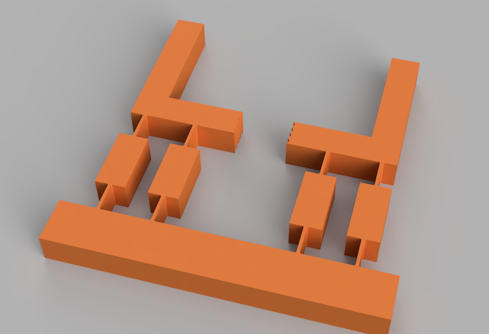
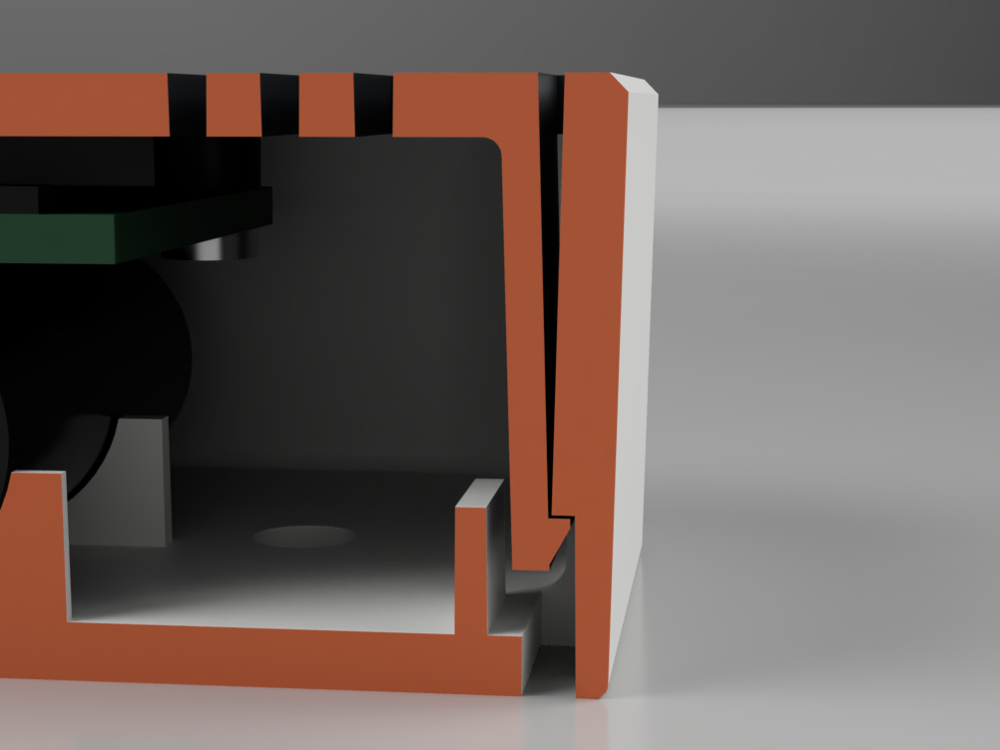

# fusion360-parametric-parts

Autodesk Fusion API scripts that generate mechanical parts from a handful of
parameters, check the engineering before they model anything, and then measure
the result to confirm it matches the numbers it was built from. There are also
three verification tools for moulded and printed parts.

Every script was run in Fusion 2705.1.30 and every number below comes from those
runs.

| Folder | What it builds or checks |
|---|---|
| [`planetary_gearset`](planetary_gearset) | Helical planetary gear set, one or two stages sharing one ring |
| [`compliant_gripper`](compliant_gripper) | Single-piece printed gripper with flexure hinges |
| [`snap_fit_housing`](snap_fit_housing) | Two-part injection-moulded housing with cantilever snap fits |
| [`verify`](verify) | Draft check, STEP round-trip check, STL watertight check |
| [`tests`](tests) | Unit tests for all the math that runs outside Fusion |

---

## Planetary gear set


*The gear stage of the 16:1 NEMA 17 gearbox these gears were designed for, as a
Fusion render. The carriers, pins, bearings and housing are separate parts; the
script generates the sun, planets and ring.*

The script builds the sun, planets and ring from tooth counts. The defaults are
18 / 18 / 54, module 1.25, a 20° pressure angle and a 15° helix, with 3 planets per
stage and 2 stages. That gives 4:1 per stage and 16:1 overall. Teeth are true
involutes, generated in Python and lofted through a closed fitted spline at each
section, which twists them into a helix.

Before modelling anything, the script refuses any gear set that cannot be built:

- **Coaxial:** `N_ring = N_sun + 2 N_planet`.
- **Assembly:** equally spaced planets only fit when `(N_sun + N_ring) / n_planets`
  is a whole number.
- **Undercut:** a standard cutter undercuts any external gear with fewer than
  `2 / sin²α` teeth, which is 18 at 20°. A 15-tooth sun looks fine on screen and
  is not.
- **Internal tip interference:** `N_ring - N_planet` must be at least 12, and
  the ring tip circle must sit outside its base circle.
- **Planet spacing:** the tip circles of neighbouring planets must clear each other.

### Phasing

Placing a planet at the right radius is not enough. Its teeth have to be rotated
so they fall into a gap of the sun and a gap of the ring at the same time. With
`φ` as the tooth phase of each gear and `θ` as the planet position (all angles in
degrees), meshing requires:

```
sun-planet:   Ns(θ - φs)/360 + Np(θ + 180 - φp)/360 ≡ 1/2   (mod 1)
planet-ring:  Np(θ - φp)/360 - Nr(θ - φr)/360       ≡ 1/2   (mod 1)
```

Eliminating the planet phase leaves one condition per stage:

```
180·Np + (Ns + Nr)·θ - Ns·φs - Nr·φr ≡ 0   (mod 360)
```

That condition holds for every planet at `θ + 360k/n` exactly when
`(Ns + Nr)/n` is a whole number. So the assembly condition falls out of the
phasing equations; it is not a separate rule.

Helical teeth add one more wrinkle. A helical tooth's phase changes along the face
at `tan β / r_pitch`. Sun and planet need opposite hands, but the planet and the
*internal* ring need the same hand. With those hands, both mesh conditions hold
at every height once they hold at one.

That matters for the two-stage version, where one ring spans both stages: the ring
presents a different tooth phase to each stage. In a real gearbox the stage-2 sun
is part of the stage-1 carrier, so its phase is fixed. The script therefore solves
stage 1 for the sun rotation and stage 2 for the carrier angle. Getting this wrong
leaves stage 2 half a tooth out, and it interferes.

### Verification (from the Fusion run)

| Check | Result |
|---|---|
| Phasing residual, both stages | 0 and 3.6e-15 teeth |
| Planet to sun gap, all 6 planets | 0.1635 mm, identical |
| Planet to ring gap, all 6 planets | 0.1139 mm, identical |
| Interference, all 36 body pairs | 0 mm³ |
| Tooth pattern volume = N × one tooth | within 1e-4 on sun, planet and ring |

Every planet shows the same gap. That only happens if the phasing is exact; an
approximate placement gives a different gap at each planet. The pattern-volume
check catches teeth that overlap their neighbours, which a visual check misses.

Planets are placed with occurrence transforms, not joints. To animate the set, use
Capture Position, add revolute joints, then couple them with motion links. Fusion
joints know nothing about gear teeth, so without motion links only the gear you
drive turns.

---

## Compliant gripper



The gripper prints as one part, with no pins, screws or springs. Each jaw hangs
from a parallelogram of two links with a flexure hinge at each end, so the jaws
stay parallel while they close.

**Sizing comes first.** A flexure bent through an angle θ over a length L has
curvature θ/L, and its outer fibre sits at t/2, so

```
ε = t·θ / (2L) = 0.8 × 0.2094 / 16 = 1.047 %
```

| Material | Yield strain | Safety factor at 12° |
|---|---|---|
| PLA | 2.0 % | 1.91 |
| PETG | 4.0 % | 3.82 |

The part is sized to the tighter PLA limit so it is safe in either material. If a
parameter change would push the safety factor below `MIN_SAFETY`, the script
stops and reports the thickest flexure that would work.

- **t = 0.8 mm is two 0.4 mm extrusion widths.** The flexure prints as solid
  perimeters with no infill. At 0.9 mm the slicer tries to fit infill into a gap
  that is too narrow and leaves voids exactly where the stress peaks.
- **Print it flat.** The bending stress then runs along the extrusion lines.
  Printed upright, the stress crosses the layer lines and the flexure
  delaminates on the first squeeze.
- **Root fillets (R0.4, 32 of them).** The strain formula assumes a uniform beam.
  Real flexures fail at the sharp internal corners at each end.
- **The enclosed-profile trap.** The region between the two links is closed on
  all four sides, so Fusion treats it as a profile too. Extruding every profile
  welds the links solid and nothing can flex. The script skips that region by
  its centroid.

### Verification (from the Fusion run)

| Check | Result |
|---|---|
| Volume after each step vs plain geometry | 24 320.000 / 20 633.600 / 20 642.390 / 20 603.990 mm³, all exact |
| Bodies, lumps | 1, 1 |
| Flexure thickness, measured on the planar faces | 0.800 mm |
| Jaw travel at 12° | 5.198 mm per jaw, gap 14.0 → 3.604 mm |

The flexure is measured on its planar faces, not its vertices. The fillet tangent
points sit inside the hinge, so a vertex scan reads 1.6 mm.

---

## Snap-fit housing



*Section through the snap arm and catch, as a Fusion render. The battery and PCB
are reference parts and are not built by the script.*

The script builds a two-part ABS wall-sensor housing, a body and a cover, joined
by two cantilever snap arms. It is designed for a straight-pull, two-plate tool,
so it needs no side actions.

The two places that would normally need a side action are the catch faces,
because a snap catch always faces its own part's closed end:

- **Body:** the catch pocket continues as a channel out through a slot in the
  hidden back face. Core steel can then form it from behind.
- **Cover:** a notch in the plate edge over each arm lets cavity steel reach down
  and form the barb's catch face. The same notch is the service slot: a 2 mm
  blade pushed in releases the arm.

Other moulding decisions in the script:

- 2.0 mm wall with 1.5° draft inside and outside.
- The front rim has a chamfer rather than a round, so the parting line sits on a
  real edge. A round on a drafted wall straddles the parting line and back-drafts
  the core.
- Ribs and bosses are 0.5–0.63 of the wall at the root.
- An over-deflection stop behind each arm tip caps the strain at 1.05 % if the
  release blade is levered hard.
- The gate well on the back face keeps the gate vestige below the mounting plane.

`snap_calc.py` is plain Python and works the snap numbers against the SABIC
CYCOLAC MG47F datasheet. It uses the allowable-strain rule from the Celanese and
Covestro snap-fit guides: 70 % of yield strain for one-time assembly, and 60 % of
that for repeated use.

```
python snap_fit_housing/snap_calc.py
allowable strain: one-time 1.82 %, repeated 1.09 %
assembly_nominal  y=0.60  eps=0.74 %  SF(rep)=1.48  SF(once)=2.47  P=3.86 N
at_stop           y=0.85  eps=1.05 %  SF(rep)=1.04  SF(once)=1.74  P=5.47 N
push-on: 7.0 N per arm, 13.9 N to close
retention: barb shear 501 N/arm, arm tension 677 N/arm
```

### Verification (from the Fusion run)

| Check | Result |
|---|---|
| Body / cover volume | 15 799.179 / 7 056.245 mm³, one lump each |
| Body / cover interference | 0 mm³ |
| Draft, +Z pull (`verify/draft_check`) | no face under 0.5°, no faces crossing the parting line |
| STEP round-trip, STL watertight | pass |

---

## Verification tools

These run on whatever design is open in Fusion.

- **`draft_check`**: finds the draft of every face against a pull direction,
  using the B-rep normals sampled over a grid. Each face is sorted as released by
  either mould half, flat, under the minimum draft, or crossing the parting line.
  Fusion's own Draft Analysis has no API.
- **`step_roundtrip`**: exports a STEP file and reads it back. It checks the file
  is complete, that it holds solids and not surfaces, and that its length unit
  matches the design. An inch file also contains SI millimetres, so reading
  `SI_UNIT` alone gives the wrong answer. It then re-imports the file into a
  scratch document and compares body count, volume and bounding box. Volumes are
  integrated at high accuracy: Fusion's default `volume` differs by about 5e-4
  between a spline-faced body and its re-imported copy.
- **`stl_check`**: meshes every visible solid and checks the mesh is printable:
  - every edge is shared by exactly two triangles, walked in opposite directions;
  - no zero-area triangles;
  - positive signed volume that matches the solid;
  - the shell count, which catches loose pieces a union silently left behind.

  It also runs from a shell: `python verify/stl_check/stl_check.py part.stl`.

---

## Running a script in Fusion

1. In Fusion, open **Utilities > Add-Ins > Scripts and Add-Ins** (Shift+S).
2. Click **+** next to *My Scripts* and choose the script's folder, for example
   `planetary_gearset`.
3. Edit the parameters at the top of the `.py` file if you want different
   geometry, then select the script and click **Run**.

Each part script opens a new design. Results go to the Text Commands window and a
summary dialog. The verify scripts run on the active design.

## Requirements

- Autodesk Fusion. Tested on version 2705.1.30, Windows. Scripts use only the
  Python bundled with Fusion and its standard library.
- To run the tests outside Fusion: Python 3.9 or newer, standard library only.
  From the repository root, run `python -m unittest discover tests`.

## License

Copyright © 2026 Navy Robson. All rights reserved.

No license is granted. You are welcome to read the code; reuse, modification
or redistribution needs written permission.
